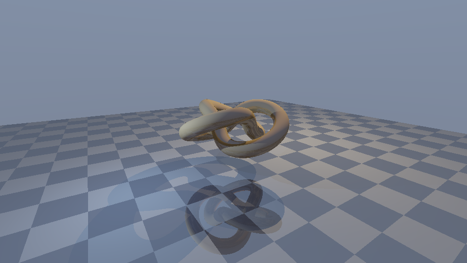
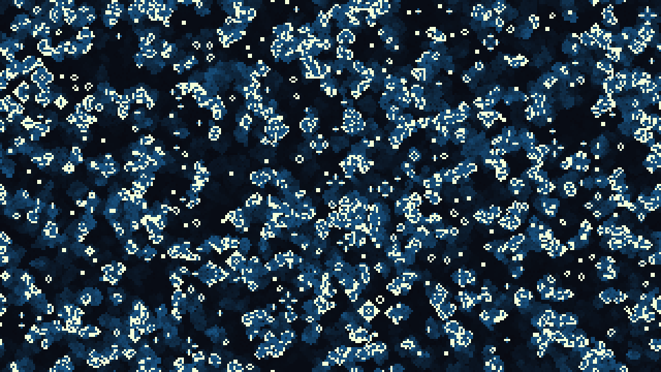
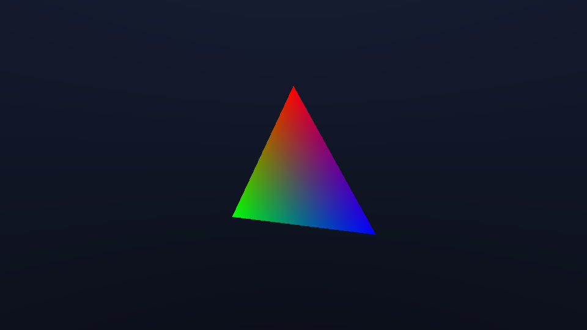
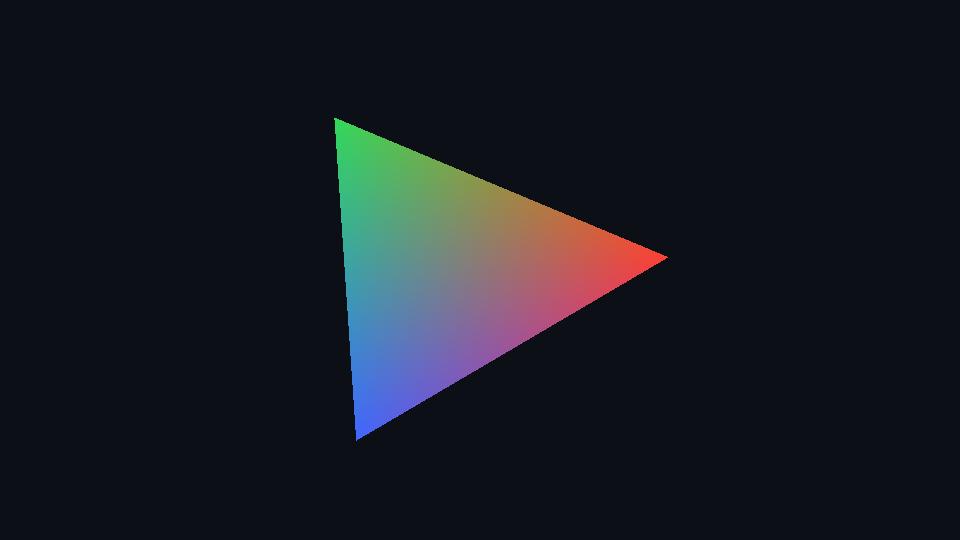
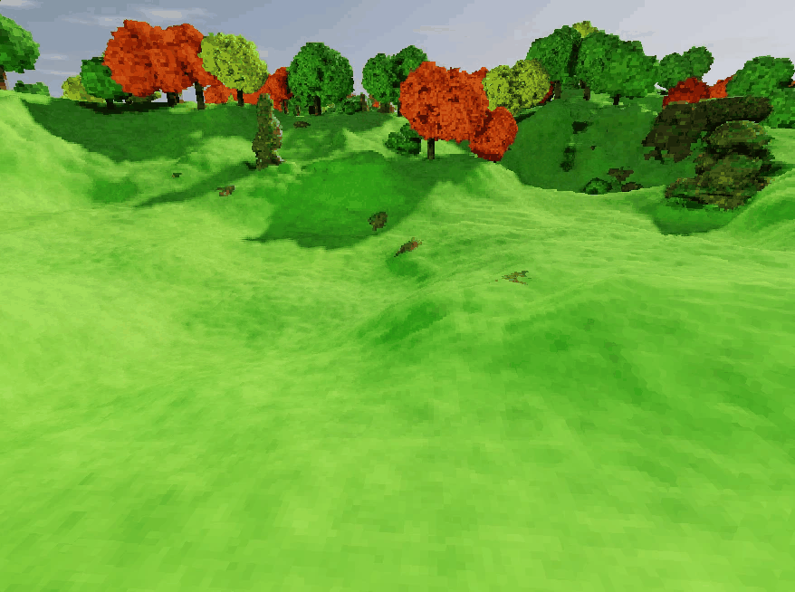

# erhi

A rendering hardware interface for Rust over Vulkan and Direct3D 12, with
hardware ray tracing: acceleration structures, ray-tracing pipelines and
inline ray queries on both.

| | |
|---|---|
|  `rt_scene` |  `life` |
|  `rt_triangle` |  `triangle` |

Each of these is an example in this repository, and comes out the same on
either backend.

## Why does this exist?

Honestly: if ease of use is what you are after, use
[wgpu](https://github.com/gfx-rs/wgpu). It runs in more places, it is
harder to misuse, and far more people have read its code.

I made this because wgpu does not yet have hardware ray-tracing pipelines,
and those were what I was after. I love experimenting with voxels, and I
wanted to play with hardware ray tracing in my engine, which I could not
do. So the engine got a rendering layer of its own, and this is that layer,
taken out so it can be used without the engine.



Reach for it if you want ray-tracing pipelines on Vulkan and Direct3D 12
from Rust today, and are content with a small crate that one engine leans
on rather than a standard.

## What it does

- **Two backends.** Vulkan and Direct3D 12 behind one API. The backend is
  chosen at run time, when the device is opened.
- **No native types in the API.** If you need the underlying Vulkan or
  Direct3D objects, for example to drive an upscaler SDK, the device and its
  images expose them as plain integer handles.
- **Ray tracing.** Bottom-level acceleration structures of triangles or
  boxes, top-level structures that can be refitted, ray-tracing pipelines
  with hit groups (closest-hit, any-hit and intersection shaders), and ray
  queries from compute shaders.
- **Rasterisation.** Render pipelines with up to eight vertex streams,
  blending, depth and stencil state, and multisampling with resolve.
  Indexed, instanced, indirect and multi-draw indirect draws. Occlusion and
  timestamp queries.
- **Compute.** Compute pipelines with direct and indirect dispatch.
- **Resources.** Buffers, images (2D, arrays, cubes, mip chains,
  multisampled) and samplers. Pipeline layouts with up to eight descriptor
  sets, and arrays of descriptors.
- **Automatic resource states.** Each command transitions the images and
  buffers it uses to the state it needs, tracked per mip level and array
  layer. Explicit transitions are available when you want them.
- **Validation.** Misuse is caught before it reaches the driver and
  returned as an `RhiError` that describes the problem.
- **No logging, no deliberate panics.** The crate does not print or log.
  Messages from the native debug layers are returned by
  `Device::debug_messages`.
- **Presentation.** Surfaces for any window that implements
  `raw-window-handle`.
- **Thread safety.** Every handle is `Send` and `Sync`. A command encoder
  is used by one thread at a time.

## Usage

```rust
let device = Device::open(DeviceOptions::default())?;

let triangle = device.build_triangle_blas(&TriangleGeometry::new(&[
    [0.0, 0.8, 0.0],
    [-0.8, -0.6, 0.0],
    [0.8, -0.6, 0.0],
]))?;
let scene = device.build_tlas(&[AccelerationStructureInstance::new(&triangle)])?;

let pipeline = device.create_ray_tracing_pipeline(
    &RayTracingPipelineDescriptor::new("triangle", &layout, library.entry("ray_gen"), 16)
        .with_miss_entries(&[library.entry("miss")])
        .with_hit_groups(&[
            HitGroup::new("triangle").with_closest_hit(library.entry("closest_hit")),
        ]),
)?;

let mut encoder = device.begin_commands()?;
encoder.trace_rays(&pipeline, &set, width, height)?;
encoder.finish()?;
```

The whole of it, with the window, is `examples/rt_triangle.rs`.

## Shaders

Shader modules are created from compiled bytecode: SPIR-V for Vulkan, DXIL
for Direct3D 12. `Device::shader_binary_format` returns the format a device
needs. The crate does not compile shaders or run any external tool.

You can compile the bytecode from any language. The hardware tests cover
these three:

| Language | Compiler | Vulkan | Direct3D 12 |
|---|---|---|---|
| Slang | `slangc` | yes | yes |
| HLSL | `dxc` | yes | yes |
| GLSL | `glslc` | yes | no (nothing compiles it to DXIL) |

The crate documentation lists what the bytecode and your descriptors must
agree on: binding numbers and registers, vertex semantics, push constants
and entry-point names.

## Examples

```text
cargo run --example window
cargo run --example triangle
cargo run --example backend_swap
cargo run --example life
cargo run --example rt_triangle
cargo run --example rt_scene
```

- `window`: a window, and pixels copied into an image and presented.
- `triangle`: a turning triangle. Shader modules, a render pipeline, a draw.
- `backend_swap`: the triangle again, on a device that F12 or space closes
  to open the other backend's on the same window. Direct3D 12 draws red on
  blue, Vulkan blue on red.
- `life`: Conway's Game of Life on compute. Space or a click starts a new
  board.
- `rt_triangle`: one triangle, ray traced. Acceleration structures, a
  ray-tracing pipeline, a ray for each pixel.
- `rt_scene`: a knot over a chequered floor with two lights. Shadows and
  reflections are rays of their own.

Each takes a backend as its first argument (`vulkan`, `dx12`; whichever
opens when left out) and a number of frames to stop after as its second.
The two `rt_` ones need a device with hardware ray tracing.

Their shaders are in `examples/shaders`, source and compiled bytes side by
side. `compile_shaders.ps1` rebuilds the compiled ones, and needs `slangc`,
`dxc` and `glslc` (all in the Vulkan SDK).

## Building and testing

```text
cargo build
cargo test
```

Built and tested on Rust 1.96 only. In theory the minimum is 1.88 (the
first release with let chains, which the source uses throughout), and
that is what `Cargo.toml` declares, but nobody has built it there yet.

`cargo test` runs what needs no hardware. The rest need a device with
hardware ray tracing and are ignored unless asked for:

```text
cargo test --features gpu_tests -- --ignored
```

Features:

- `vulkan`, `dx12`: the backends. Both on by default; `dx12` only does
  anything on Windows.
- `gpu_tests`: compiles the tests that need a device.

## State

- Used daily on Windows, on both backends.
- Tested on NVIDIA hardware only so far. AMD and Intel are expected to
  work and have not been tried: reports are welcome.
- Builds on Linux, and its tests and examples pass there on a software
  Vulkan driver (llvmpipe, under WSL). Not yet run on a Linux GPU driver.
- Metal is not implemented yet, but might be. No WebGPU or OpenGL is yet
  planned.
- The API is not stable yet and will change between versions.

## Related projects

- [wgpu](https://github.com/gfx-rs/wgpu): the WebGPU API in Rust, over
  Vulkan, Metal, Direct3D 12, OpenGL and the web. What most Rust projects
  should use.
- [Dawn](https://dawn.googlesource.com/dawn): Chromium's WebGPU, in C++.
- [NVRHI](https://github.com/NVIDIA-RTX/NVRHI): NVIDIA's rendering hardware
  interface over Direct3D 11, Direct3D 12 and Vulkan, in C++. The closest
  thing to this crate in shape: resource states tracked for you, shaders
  as compiled bytes, ray tracing throughout.
- [NRI](https://github.com/NVIDIA-RTX/NRI): NVIDIA's lower-level render
  interface, in C++, nearer the native APIs.
- [Diligent Engine](https://github.com/DiligentGraphics/DiligentEngine) and
  [The Forge](https://github.com/ConfettiFX/The-Forge): cross-platform
  rendering layers in C++ with ray tracing.
- [ash](https://github.com/ash-rs/ash) and
  [windows-rs](https://github.com/microsoft/windows-rs): the Vulkan and
  Direct3D 12 bindings this crate is built on. Use them directly if you
  want one API with nothing in between.
- [vulkano](https://github.com/vulkano-rs/vulkano): a safe Rust wrapper of
  Vulkan alone.

## AI disclosure

This was made with assistance from AI. The design and the direction are
mine, as is most of the code; the tests, tidying and a lot of validity
checks were done alongside an AI model. Every change was built, run on real
hardware on both backends and read before it was kept. If something here is
wrong, that is on me, not the tool: please open an issue.

## Licence

MIT or Apache-2.0, at your option: see `LICENSE-MIT` and `LICENSE-APACHE`.
